

<picture><source media="(prefers-color-scheme: dark)" srcset="assets/banners/header-dark.svg"><source media="(prefers-color-scheme: light)" srcset="assets/banners/header-light.svg"></picture>

<a href="scripts/ascii/"><picture><source media="(prefers-color-scheme: dark)" srcset="assets/ascii/portrait-dark.svg"><source media="(prefers-color-scheme: light)" srcset="assets/ascii/portrait-light.svg">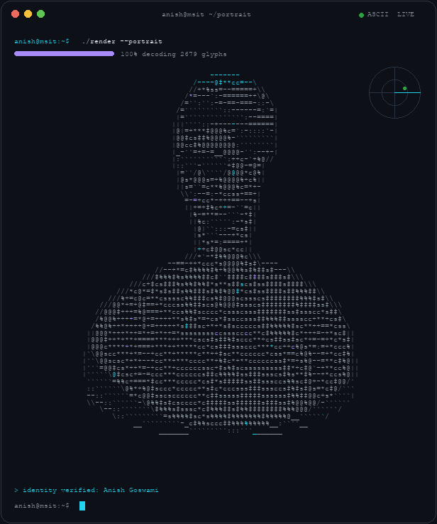</picture></a>

<picture><source media="(prefers-color-scheme: dark)" srcset="assets/hero/hello-dark.svg"><source media="(prefers-color-scheme: light)" srcset="assets/hero/hello-light.svg"></picture> 
<picture><source media="(prefers-color-scheme: dark)" srcset="assets/hero/roles-dark.svg"><source media="(prefers-color-scheme: light)" srcset="assets/hero/roles-light.svg"></picture> 
<picture><source media="(prefers-color-scheme: dark)" srcset="assets/hero/chips-dark.svg"><source media="(prefers-color-scheme: light)" srcset="assets/hero/chips-light.svg"></picture>

<picture><source media="(prefers-color-scheme: dark)" srcset="assets/hero/welcome-dark.svg"><source media="(prefers-color-scheme: light)" srcset="assets/hero/welcome-light.svg"></picture> 
<a href="https://github.com/Anishgoswami-dev"><picture><source media="(prefers-color-scheme: dark)" srcset="assets/hero/btn-follow-dark.svg"><source media="(prefers-color-scheme: light)" srcset="assets/hero/btn-follow-light.svg"></picture></a><a href="https://github.com/Anishgoswami-dev?tab=repositories"><picture><source media="(prefers-color-scheme: dark)" srcset="assets/hero/btn-work-dark.svg"><source media="(prefers-color-scheme: light)" srcset="assets/hero/btn-work-light.svg"></picture></a>

 

<picture><source media="(prefers-color-scheme: dark)" srcset="assets/sections/ticker-dark.svg"><source media="(prefers-color-scheme: light)" srcset="assets/sections/ticker-light.svg"></picture>

<picture><source media="(prefers-color-scheme: dark)" srcset="assets/sections/divider-dark.svg"><source media="(prefers-color-scheme: light)" srcset="assets/sections/divider-light.svg"></picture>

<picture><source media="(prefers-color-scheme: dark)" srcset="assets/titles/about-dark.svg"><source media="(prefers-color-scheme: light)" srcset="assets/titles/about-light.svg"></picture>

<picture><source media="(prefers-color-scheme: dark)" srcset="assets/sections/about-dark.svg"><source media="(prefers-color-scheme: light)" srcset="assets/sections/about-light.svg"></picture>

<picture><source media="(prefers-color-scheme: dark)" srcset="assets/sections/divider2-dark.svg"><source media="(prefers-color-scheme: light)" srcset="assets/sections/divider2-light.svg"></picture>

<picture><source media="(prefers-color-scheme: dark)" srcset="assets/titles/toolbox-dark.svg"><source media="(prefers-color-scheme: light)" srcset="assets/titles/toolbox-light.svg"></picture>

<picture><source media="(prefers-color-scheme: dark)" srcset="assets/sections/toolbox-dark.svg"><source media="(prefers-color-scheme: light)" srcset="assets/sections/toolbox-light.svg"></picture>

<picture><source media="(prefers-color-scheme: dark)" srcset="assets/sections/ticker2-dark.svg"><source media="(prefers-color-scheme: light)" srcset="assets/sections/ticker2-light.svg"></picture>

<picture><source media="(prefers-color-scheme: dark)" srcset="assets/sections/divider-dark.svg"><source media="(prefers-color-scheme: light)" srcset="assets/sections/divider-light.svg"></picture>

<picture><source media="(prefers-color-scheme: dark)" srcset="assets/titles/work-dark.svg"><source media="(prefers-color-scheme: light)" srcset="assets/titles/work-light.svg"></picture>

<!-- FEATURED:START -->
<table>
<tr>
<td width="50%" align="center" valign="top">
<a href="https://github.com/Anishgoswami-dev/plant_Disease_Detection"><picture><source media="(prefers-color-scheme: dark)" srcset="assets/projects/plantdiseasedetection-dark.svg?v=1793132034"><source media="(prefers-color-scheme: light)" srcset="assets/projects/plantdiseasedetection-light.svg?v=1793132034"></picture></a> 
<a href="https://plant-disease-detection-seven-tau.vercel.app"><picture><source media="(prefers-color-scheme: dark)" srcset="assets/projects/plantdiseasedetection-band-dark.svg?v=1793132034"><source media="(prefers-color-scheme: light)" srcset="assets/projects/plantdiseasedetection-band-light.svg?v=1793132034"></picture></a>
</td>
<td width="50%" align="center" valign="top">
<a href="https://github.com/Anishgoswami-dev/AI-Website-Copy-Generator-for-Local-Businesses"><picture><source media="(prefers-color-scheme: dark)" srcset="assets/projects/aiwebsitecopygeneratorforlocalbusinesses-dark.svg?v=1793132034"><source media="(prefers-color-scheme: light)" srcset="assets/projects/aiwebsitecopygeneratorforlocalbusinesses-light.svg?v=1793132034"></picture></a> 
<a href="https://github.com/Anishgoswami-dev/AI-Website-Copy-Generator-for-Local-Businesses"><picture><source media="(prefers-color-scheme: dark)" srcset="assets/projects/aiwebsitecopygeneratorforlocalbusinesses-band-dark.svg?v=1793132034"><source media="(prefers-color-scheme: light)" srcset="assets/projects/aiwebsitecopygeneratorforlocalbusinesses-band-light.svg?v=1793132034"></picture></a>
</td>
</tr>
<tr>
<td width="50%" align="center" valign="top">
<a href="https://github.com/Anishgoswami-dev/AI-Content-Marketing-using-UGC"><picture><source media="(prefers-color-scheme: dark)" srcset="assets/projects/aicontentmarketingusingugc-dark.svg?v=1793132034"><source media="(prefers-color-scheme: light)" srcset="assets/projects/aicontentmarketingusingugc-light.svg?v=1793132034"></picture></a> 
<a href="https://github.com/Anishgoswami-dev/AI-Content-Marketing-using-UGC"><picture><source media="(prefers-color-scheme: dark)" srcset="assets/projects/aicontentmarketingusingugc-band-dark.svg?v=1793132034"><source media="(prefers-color-scheme: light)" srcset="assets/projects/aicontentmarketingusingugc-band-light.svg?v=1793132034"></picture></a>
</td>
<td width="50%" align="center" valign="top">
<a href="https://github.com/Anishgoswami-dev/AI-SEO-Blog-Content-Cluster"><picture><source media="(prefers-color-scheme: dark)" srcset="assets/projects/aiseoblogcontentcluster-dark.svg?v=1793132034"><source media="(prefers-color-scheme: light)" srcset="assets/projects/aiseoblogcontentcluster-light.svg?v=1793132034"></picture></a> 
<a href="https://github.com/Anishgoswami-dev/AI-SEO-Blog-Content-Cluster"><picture><source media="(prefers-color-scheme: dark)" srcset="assets/projects/aiseoblogcontentcluster-band-dark.svg?v=1793132034"><source media="(prefers-color-scheme: light)" srcset="assets/projects/aiseoblogcontentcluster-band-light.svg?v=1793132034"></picture></a>
</td>
</tr>
<tr>
<td width="50%" align="center" valign="top">
<a href="https://github.com/Anishgoswami-dev/Fasal_Dristhi"><picture><source media="(prefers-color-scheme: dark)" srcset="assets/projects/fasaldristhi-dark.svg?v=1793132034"><source media="(prefers-color-scheme: light)" srcset="assets/projects/fasaldristhi-light.svg?v=1793132034"></picture></a> 
<a href="https://github.com/Anishgoswami-dev/Fasal_Dristhi"><picture><source media="(prefers-color-scheme: dark)" srcset="assets/projects/fasaldristhi-band-dark.svg?v=1793132034"><source media="(prefers-color-scheme: light)" srcset="assets/projects/fasaldristhi-band-light.svg?v=1793132034"></picture></a>
</td>
<td width="50%" align="center" valign="top">
<a href="https://github.com/Anishgoswami-dev/food_delivary"><picture><source media="(prefers-color-scheme: dark)" srcset="assets/projects/fooddelivary-dark.svg?v=1793132034"><source media="(prefers-color-scheme: light)" srcset="assets/projects/fooddelivary-light.svg?v=1793132034"></picture></a> 
<a href="https://github.com/Anishgoswami-dev/food_delivary"><picture><source media="(prefers-color-scheme: dark)" srcset="assets/projects/fooddelivary-band-dark.svg?v=1793132034"><source media="(prefers-color-scheme: light)" srcset="assets/projects/fooddelivary-band-light.svg?v=1793132034"></picture></a>
</td>
</tr>
</table>
<!-- FEATURED:END -->

<a href="https://github.com/Anishgoswami-dev?tab=repositories"><picture><source media="(prefers-color-scheme: dark)" srcset="assets/sections/more-dark.svg?v=1793132034"><source media="(prefers-color-scheme: light)" srcset="assets/sections/more-light.svg?v=1793132034"></picture></a>

<!-- MORE:START -->
<a href="https://github.com/Anishgoswami-dev/NexaMind"><picture><source media="(prefers-color-scheme: dark)" srcset="assets/sections/more-0-dark.svg?v=1793132034"><source media="(prefers-color-scheme: light)" srcset="assets/sections/more-0-light.svg?v=1793132034"></picture></a>
<a href="https://github.com/Anishgoswami-dev/Coffee_Website"><picture><source media="(prefers-color-scheme: dark)" srcset="assets/sections/more-1-dark.svg?v=1793132034"><source media="(prefers-color-scheme: light)" srcset="assets/sections/more-1-light.svg?v=1793132034"></picture></a>
<a href="https://github.com/Anishgoswami-dev/Tic_Tac_Toe"><picture><source media="(prefers-color-scheme: dark)" srcset="assets/sections/more-2-dark.svg?v=1793132034"><source media="(prefers-color-scheme: light)" srcset="assets/sections/more-2-light.svg?v=1793132034"></picture></a>
<a href="https://github.com/Anishgoswami-dev/nassau_candy_distributor"><picture><source media="(prefers-color-scheme: dark)" srcset="assets/sections/more-3-dark.svg?v=1793132034"><source media="(prefers-color-scheme: light)" srcset="assets/sections/more-3-light.svg?v=1793132034"></picture></a>
<a href="https://github.com/Anishgoswami-dev?tab=repositories"><picture><source media="(prefers-color-scheme: dark)" srcset="assets/sections/more-4-dark.svg?v=1793132034"><source media="(prefers-color-scheme: light)" srcset="assets/sections/more-4-light.svg?v=1793132034"></picture></a>
<!-- MORE:END -->

<picture><source media="(prefers-color-scheme: dark)" srcset="assets/sections/divider2-dark.svg"><source media="(prefers-color-scheme: light)" srcset="assets/sections/divider2-light.svg"></picture>

<picture><source media="(prefers-color-scheme: dark)" srcset="assets/titles/stats-dark.svg"><source media="(prefers-color-scheme: light)" srcset="assets/titles/stats-light.svg"></picture>

<picture><source media="(prefers-color-scheme: dark)" srcset="assets/stats/dashboard-dark.svg?v=1793118914"><source media="(prefers-color-scheme: light)" srcset="assets/stats/dashboard-light.svg?v=1793118914"></picture>

<picture><source media="(prefers-color-scheme: dark)" srcset="assets/sections/divider-dark.svg"><source media="(prefers-color-scheme: light)" srcset="assets/sections/divider-light.svg"></picture>

<picture><source media="(prefers-color-scheme: dark)" srcset="assets/titles/city-dark.svg"><source media="(prefers-color-scheme: light)" srcset="assets/titles/city-light.svg"></picture>

<picture><source media="(prefers-color-scheme: dark)" srcset="assets/3d/contribution-dark.svg?v=1793135329"><source media="(prefers-color-scheme: light)" srcset="assets/3d/contribution-light.svg?v=1793135329"></picture>

<picture><source media="(prefers-color-scheme: dark)" srcset="assets/sections/divider2-dark.svg"><source media="(prefers-color-scheme: light)" srcset="assets/sections/divider2-light.svg"></picture>

<picture><source media="(prefers-color-scheme: dark)" srcset="assets/titles/activity-dark.svg"><source media="(prefers-color-scheme: light)" srcset="assets/titles/activity-light.svg"></picture>

<picture><source media="(prefers-color-scheme: dark)" srcset="assets/live/greeting-dark.svg?v=1793131784"><source media="(prefers-color-scheme: light)" srcset="assets/live/greeting-light.svg?v=1793131784"></picture>

<picture><source media="(prefers-color-scheme: dark)" srcset="assets/sections/divider-dark.svg"><source media="(prefers-color-scheme: light)" srcset="assets/sections/divider-light.svg"></picture>

<picture><source media="(prefers-color-scheme: dark)" srcset="assets/titles/play-dark.svg"><source media="(prefers-color-scheme: light)" srcset="assets/titles/play-light.svg"></picture>

<a href="https://anishgoswami-dev.github.io/Anishgoswami-dev/"><picture><source media="(prefers-color-scheme: dark)" srcset="assets/sections/arcade-dark.svg"><source media="(prefers-color-scheme: light)" srcset="assets/sections/arcade-light.svg"></picture></a>

<picture><source media="(prefers-color-scheme: dark)" srcset="assets/sections/divider2-dark.svg"><source media="(prefers-color-scheme: light)" srcset="assets/sections/divider2-light.svg"></picture>

<picture><source media="(prefers-color-scheme: dark)" srcset="assets/titles/connect-dark.svg"><source media="(prefers-color-scheme: light)" srcset="assets/titles/connect-light.svg"></picture>

<a href="mailto:anishgoswami20006@gmail.com"><picture><source media="(prefers-color-scheme: dark)" srcset="assets/contact/email-dark.svg"><source media="(prefers-color-scheme: light)" srcset="assets/contact/email-light.svg"></picture></a>
<a href="https://github.com/Anishgoswami-dev"><picture><source media="(prefers-color-scheme: dark)" srcset="assets/contact/github-dark.svg"><source media="(prefers-color-scheme: light)" srcset="assets/contact/github-light.svg"></picture></a>
<a href="https://www.linkedin.com/in/anish-goswami-06a1a1333/"><picture><source media="(prefers-color-scheme: dark)" srcset="assets/contact/linkedin-dark.svg"><source media="(prefers-color-scheme: light)" srcset="assets/contact/linkedin-light.svg"></picture></a>
<a href="https://www.youtube.com/@Anishgoswami8082"><picture><source media="(prefers-color-scheme: dark)" srcset="assets/contact/youtube-dark.svg"><source media="(prefers-color-scheme: light)" srcset="assets/contact/youtube-light.svg"></picture></a>
<a href="https://discord.com/users/anish0331"><picture><source media="(prefers-color-scheme: dark)" srcset="assets/contact/discord-dark.svg"><source media="(prefers-color-scheme: light)" srcset="assets/contact/discord-light.svg"></picture></a>
<a href="https://www.instagram.com/anish_goswami_828"><picture><source media="(prefers-color-scheme: dark)" srcset="assets/contact/instagram-dark.svg"><source media="(prefers-color-scheme: light)" srcset="assets/contact/instagram-light.svg"></picture></a>

<a href="https://github.com/Anishgoswami-dev/Anishgoswami-dev"><picture><source media="(prefers-color-scheme: dark)" srcset="assets/sections/star-dark.svg"><source media="(prefers-color-scheme: light)" srcset="assets/sections/star-light.svg"></picture></a>

<picture><source media="(prefers-color-scheme: dark)" srcset="assets/banners/footer-dark.svg"><source media="(prefers-color-scheme: light)" srcset="assets/banners/footer-light.svg"></picture>

